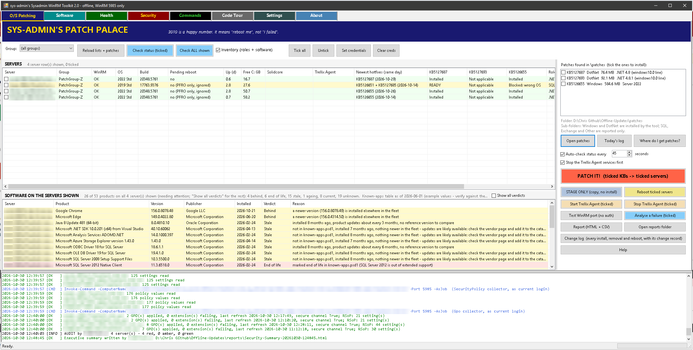
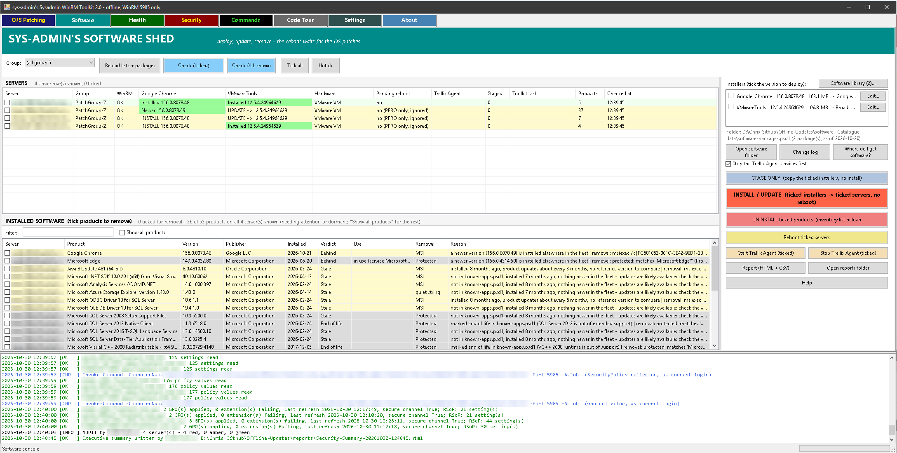
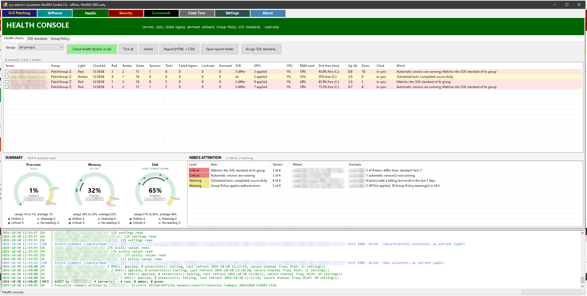
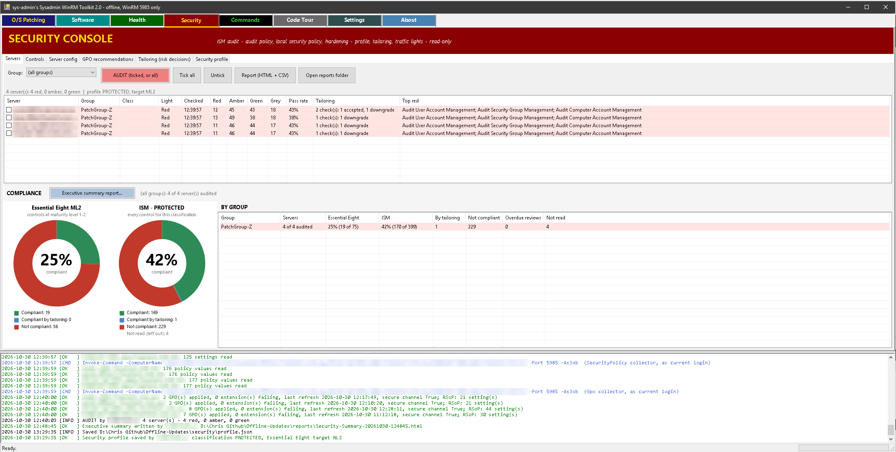
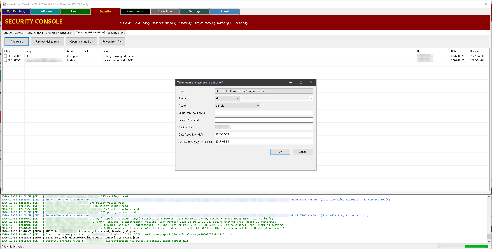
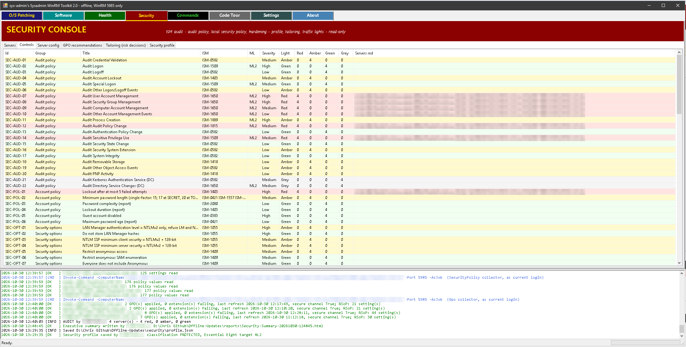
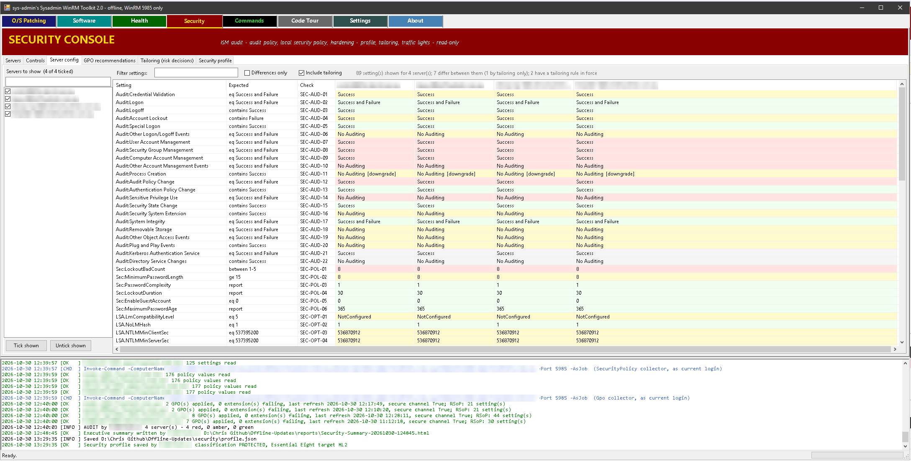
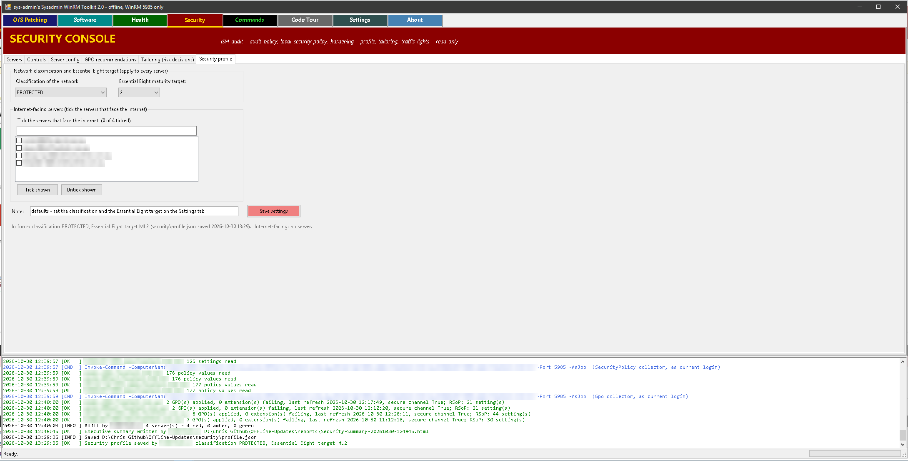
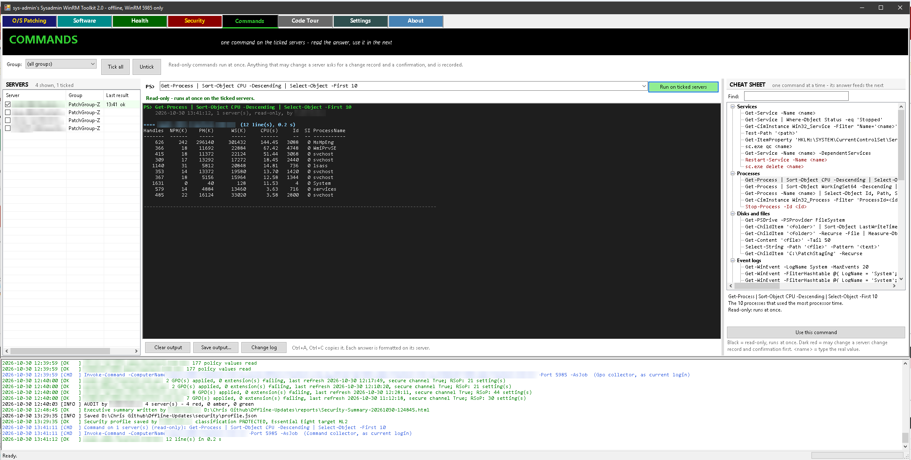
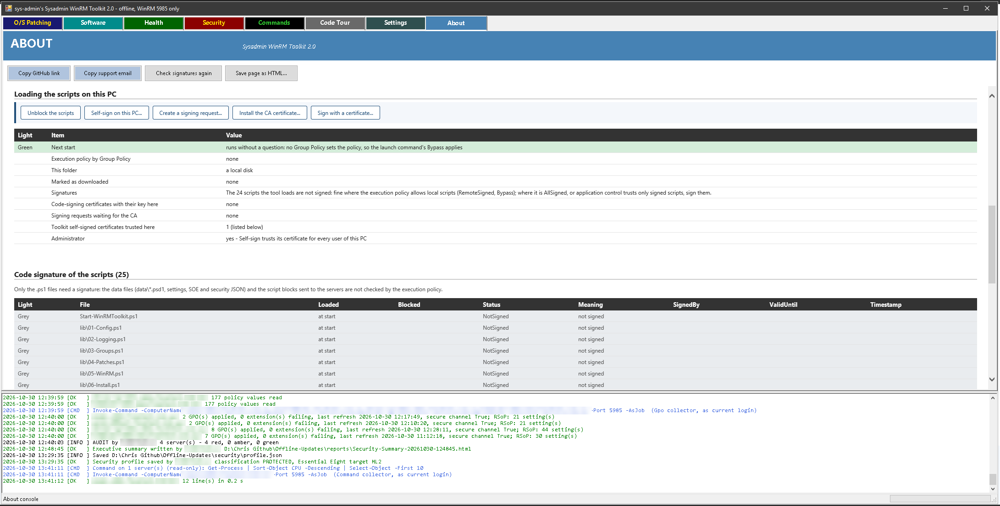

# Sysadmin WinRM Toolkit - patching, health and security over WinRM, offline

A readable Windows PowerShell 5.1 tool with a Windows Forms window. Five consoles (tabs) share one engine:
every action is one WinRM connection to the servers in your group files on **TCP 5985**, nothing is ever
downloaded, no agent or service is installed on any server (a software run uses one-shot scheduled tasks, removed
once their result is recorded), and credentials are only ever requested in the foreground with the standard Windows
prompt and kept in memory. Every change to a server asks for a change record first and keeps it with the server.

| Console | What it does | Changes a server? |
|---|---|---|
| **O/S Patching** | Reads the update files in `patches\`, asks every server for its build, hotfixes, update history, pending reboot, free disk, the Trellix Solidcore mode and the Trellix Agent services, shows **Installed / READY / Blocked: why** per server and file, and installs the ticked Windows and .NET updates after the plan, a change record and the pre-action confirmations (VMware snapshot, Trellix Solidcore Update Mode ... - set on the Settings tab). After a failure, **Analyse a failure** reads the server's own logs and says where it broke. Shows roles, software currency (Current / Behind / Stale / Ageing / End of life) and SQL / Exchange patch levels. | Yes: install and reboot |
| **Software** | Deploys and updates third-party software from a catalogue (data\software-packages.psd1, installers in software\), VMware Tools first, with the reboot suppressed so it is taken with the OS patches. Stages installers ahead of the window. Removes old or dormant products, never protected ones or what the server's SOE standard requires. | Yes: install, update, removal |
| **Health** | Automatic services not running, scheduled tasks with a failing last result, failed logons (4625) and account lockouts (4740), dormant software, disk, uptime, event-log errors, time sync, expiring certificates, memory, the agents every server should run. **Group Policy**: which GPOs apply where, failed policy extensions and errors, the last refresh, the trust with the domain. **SOE standards** you compose yourself and compare the fleet against. | No |
| **Security** | An ISM audit: audit policy and local security policy (auditpol, secedit), hardening settings, application control, antivirus and EDR, firewall, LAPS, local administrators, logging, patch timeframes. A **security profile** (classification, Essential Eight maturity target) plus per-server internet-facing marks on the group-file lines, **tailoring** (recorded risk decisions) and Red / Amber / Green / Grey lights per server and per control. **GPO recommendations**: what Group Policy is missing or sets too weakly, the value today, which GPO to put each setting in, and - checked on each server - whether applying it would break something in use (impact found / check first / no impact found). | No |
| **Commands** | One PowerShell command on the ticked servers, every server's answer underneath - for an investigation, one step at a time. A **cheat sheet** of one-line commands (services, processes, disks, event logs, software, reboots, network, accounts) puts a command in the box with its `<placeholder>` ready to type over. | Only a command that may change one: change record and confirmation first |

Long button and page names are shortened in this manual: **Report** stands for "Report (HTML + CSV)", **AUDIT** for
"AUDIT (ticked, or all)", **Tailoring** for "Tailoring (risk
decisions)", and so on - the window shows the full text.

Every console but Commands has a **Report** button (Commands has **Save output...** instead): an HTML file (summary on top, data below, works offline) and CSV files
(data only). The **Code Tour** tab explains every part as a formatted page - the explanation, its live source code and eleven pictures - with a menu by part, Previous / Next, and "Save whole tour as HTML" for reading or printing outside the tool.
The **Settings** tab sets what the tool asks and records before a change - which products are in use (so which
confirmations pop up), the change management system, what a change record must hold and which actions need one -
plus the running log and the warning thresholds. The **About** tab shows the version, the GitHub link, this copy's
PowerShell set-up and the code signature of every script.

The window title and the O/S Patching banner carry the operator's name (`OperatorName`, default `sys-admin`; on the
Settings tab).

## Folder layout

| Path | Purpose |
|---|---|
| `Start-WinRMToolkit.ps1` | The launcher. Sets the root folder, loads `lib\*.ps1` from an explicit list, opens the window. |
| `lib\01-Config.ps1` | The defaults (`$Config`): port, timeouts, thresholds, folders, patch types, console colours, confirmations, change rules. The Settings tab saves its changes over them. |
| `lib\02-Logging.ps1` | `Write-PatchLog`: writes to `logs\`, the console and the window, colour coded, with the operator identity. |
| `lib\03-Groups.ps1` | Parses the group `.txt` files and their `# class:` and `# soe:` directives. |
| `lib\04-Patches.ps1` | Scans `patches\<type>\`, reads the target build, signature and hash of every file. |
| `lib\05-WinRM.ps1` | `Invoke-Collector` (the fan-out engine), status check, credential prompt, `Test-WSMan`, the slice copy. |
| `lib\06-Install.ps1` | The plan, the pre-action confirmations, file staging, DISM install, progress, reboot. |
| `lib\07-Gui.ps1` | The window shell: coloured tabs, banners, toolbars, grids, tick lists, details window, the Code Tour tab. |
| `lib\08-CodeTour.ps1` | The training text. The check catalogues and the settings keys are rendered from the code. |
| `lib\09-Reports.ps1` | `Export-ConsoleReport`: HTML + CSV for every console. |
| `lib\10-Checks.ps1` | The check model (`New-Check`, `Invoke-Checks`), verdicts, lights, JSON and data-file readers. |
| `lib\11-ChangeLog.ps1` | The change record asked before every change (per the Settings tab), `changes\change-log.csv`, the Change log window. |
| `lib\12-Settings.ps1` | What the Settings tab may change, checked against its type; `settings\settings.json` laid over the defaults at start-up. |
| `lib\13-GroupPolicy.ps1` | The Group Policy collector (Health and Security): GPOs applied or filtered, extension results, errors, last refresh, secure channel, which GPO sets which value (RSoP). |
| `lib\20-Console-Patching.ps1` | The O/S Patching tab: grid, inventory, software currency, report. |
| `lib\21-Patching-Analysis.ps1` | The O/S Patching tab's **Analyse a failure**: the server's logs read after a failed install, weighed into findings and a timeline. |
| `lib\30-Console-Health.ps1` | The Health tab: collectors, seventeen checks, the summary under the grid (processor, memory and disk dials, what needs attention), SOE standards, the Group Policy page. |
| `lib\40-Console-Security.ps1` | The Security tab: audit-policy collector, 118 checks, profile, tailoring, six views. |
| `lib\45-Security-Gpo.ps1` | The Security tab's GPO recommendations: the impact checks run on the servers, the gap per setting, the GPO plan. |
| `lib\46-Security-Compliance.ps1` | The Security tab's compliance dashboard (Essential Eight and ISM charts, by group) and the executive summary report. |
| `lib\50-Console-Software.ps1` | The Software tab: package vetting, verdicts, staging, install / update / removal as tasks on the server, report. |
| `lib\60-Console-Settings.ps1` | The Settings tab: confirmations, change records, the running log, thresholds. |
| `lib\70-Console-About.ps1` | The About tab: version, GitHub link, this copy, the code signature of every script. |
| `lib\80-Console-Commands.ps1` | The Commands tab: one command on the ticked servers, the read-only check (`Get-CommandRisk`), the cheat sheet. |
| `settings\settings.json` | What the Settings tab saved (only what differs from the defaults); `software-shown.json` beside it, the packages the Software console shows. Git-ignored. See `settings\README.txt`. |
| `data\*.psd1` | The catalogues that replace the internet: known apps, product patches, benign services, agents, SOE configuration points, expected security settings, the ISM catalogue, the software packages, the Commands cheat sheet, the GPO guidance. See `data\README.txt`. |
| `patches\Windows\`, `patches\DotNet\` | Updates the tool installs (cumulative updates, .NET). See `patches\README.txt`. |
| `patches\SQL\`, `patches\Exchange\`, `patches\Other\` | Updates the tool detects and reports only ("By hand"). |
| `software\<package>\` | Installers for the Software tab, one folder per package. The installers are git-ignored, and so is `software\_info\` (the vetting cache). See `software\README.txt`. |
| `changes\change-log.csv` | Every install, removal, reboot and command that may change a server, with its change reference. Git-ignored. |
| `soe\*.json` | Your SOE standards (composed in the Health tab, editable in Notepad). Git-ignored. |
| `security\profile.json`, `security\tailoring.json` | The security profile and the tailoring rules. Git-ignored. |
| `reports\` | One HTML and one or more CSV files per Report button press. Git-ignored. |
| `logs\` | `Patcher-YYYYMMDD.log`, one file per day. Git-ignored. |
| `signing\` | Code-signing requests made on the About tab (`.req` for your certificate authority, `.txt` saying what to ask for). Git-ignored. |
| `images\*.png` | The eleven Code Tour pictures, and the screenshots of the consoles shown in this manual (`screen-*.png`). |
| `Sign-Toolkit.ps1` | Signs the launcher, `lib\` and itself with your code-signing certificate, or reports their signatures (`-Check`). See Code signing. |
| `README.txt` | Plain text, for when the tool will not start: how to launch it, unblock it and sign it with commands typed at the PowerShell prompt. |
| `PatchGroup-A/B/C.txt` | Sample server lists. One name per line, `#` for comments. |

## Running it

The tool runs from its files, so `.ps1` execution must be allowed on the machine that runs it:

```powershell
powershell.exe -ExecutionPolicy Bypass -File .\Start-WinRMToolkit.ps1
```

or right-click `Start-WinRMToolkit.ps1` and choose *Run with PowerShell*. Where the execution policy is AllSigned, or
application control trusts only signed scripts, sign the scripts first (see Code signing below). If application
control puts PowerShell into ConstrainedLanguage mode, the tool stops with a clear message, because WinForms cannot
run in that mode at all.

**Trust boundary.** Everything in this folder runs as you on every server. Keep the folder writable only by the
operators, never on an open share. The launcher loads an explicit list of `lib\` files and reports any extra `.ps1`
it finds there instead of running it. Reports, logs, SOE standards and the security files contain host names,
account names and findings; they are git-ignored on purpose.

**Functions only, no window** (fault finding, or to run one step by hand):

```powershell
$NoGui = $true
. .\Start-WinRMToolkit.ps1
Get-PatchGroups; Get-PatchFiles
Get-ServerStatus -ComputerName SRV-APP01
$Results['Status']['SRV-APP01'] | Format-List
Get-ServerHealth -ComputerName SRV-APP01
Invoke-Checks -Console Health -Server SRV-APP01 | Format-Table Id, Light, Evidence -Wrap
Show-ToolkitGui                         # open the window whenever you like
```

Run the tool as the account that is a local administrator on the target servers. It never elevates itself. The
Security console's `auditpol` and `secedit` collectors need that administrator right; without it their rows say so.
The PowerShell console stays open behind the window and shows the same log in colour.

## Code signing

Where PowerShell's execution policy is **AllSigned**, or application control (AppLocker or WDAC script rules, and
similar products) trusts only signed scripts, sign the toolkit with your organisation's code-signing certificate:

```powershell
powershell.exe -ExecutionPolicy Bypass -File .\Sign-Toolkit.ps1                          # lists your code-signing certificates
powershell.exe -ExecutionPolicy Bypass -File .\Sign-Toolkit.ps1 -Thumbprint <thumbprint>  # signs the tool's scripts
powershell.exe -ExecutionPolicy Bypass -File .\Sign-Toolkit.ps1 -Check                    # reports each signature, signs nothing
```

What was tested (2026-10-21, Windows PowerShell 5.1, execution policy AllSigned):

* **Only the `.ps1` files need a signature**: the launcher, `lib\` and `Sign-Toolkit.ps1` itself. The data files
  (`data\*.psd1`, read with `Import-PowerShellDataFile` or the parser), the JSON files the tool writes and the script
  blocks it sends to the servers are not checked by the execution policy. The Software tab can therefore still register
  packages in `data\software-packages.psd1` after signing, and nothing has to be signed on the servers.
* A signed copy runs exactly as before. Signing keeps every file ASCII.
* **Sign last.** Editing a signed file shows as `HashMismatch`; text added after the signature block shows as
  `NotSigned`. Either way an AllSigned policy refuses that file. Sign again after every update.
* **Trust** comes from the PCs that run the tool, usually by Group Policy: the issuing CA in Trusted Root Certification
  Authorities, and for AllSigned without a prompt the signing certificate in Trusted Publishers; for application
  control, a publisher rule for the certificate. A PC that does not trust the chain refuses the files with the
  misleading message "is not digitally signed" - `Sign-Toolkit.ps1 -Check`, or the About tab, shows the real status.
* **Timestamp.** Without one, the signatures stop being valid when the certificate expires. `-TimestampServer <url>`
  adds an RFC 3161 timestamp; that is the only network call the script can make, and only when you give it (an internal
  timestamp authority works). The toolkit itself never goes online.
* **On the servers.** Signing changes nothing there: the tool sends script blocks over WinRM, which the execution
  policy does not check. Not tested: a server whose application control runs remote sessions in ConstrainedLanguage.
  The remote scripts use .NET and COM calls that ConstrainedLanguage blocks, and signing the files on the operator PC
  does not change a server's language mode.

The About tab lists the signature of every script: who signed it, until when, whether it carries a timestamp, and
whether this PC trusts it.

### From the About tab

If PowerShell asks before every script at the start, the About tab's **Loading the scripts on this PC** says why. It
shows what the next start will meet: the execution policy a Group Policy sets (it overrides the launch command's
`-ExecutionPolicy Bypass`) or an AllSigned set by hand (*Run with PowerShell* keeps that one; the command line does
not), the scripts that carry Windows' "downloaded from the internet" mark (a download, or every
file of a zip extracted from one), a folder on a network path in the Internet zone, and the signatures. The buttons sit
in that section of the page, so they scroll with the status they change. They act on this PC only, each after a Yes:

| Button | What it does |
|---|---|
| **Unblock the scripts** | Removes the "downloaded" mark from the tool's scripts. The files themselves do not change. |
| **Self-sign on this PC...** | Makes a code-signing certificate here (the key size and hash you choose, below; the key cannot be exported; valid 2 years) and puts it in Trusted Root Certification Authorities and Trusted Publishers: for every user of the PC when the tool runs as an administrator, otherwise for you (Windows asks you to confirm the root certificate). Then it signs every script and deletes the certificate's private key, so nothing else can ever be signed with it. Self-sign again after an update; the older toolkit certificates are taken out of the trust. |
| **Create a signing request...** | The managed way. The common name starts as `WinRM Toolkit code signing (<this PC>)`: the key never leaves this PC, so the name says which PC signs (your CA may put a name of its own in its place). A key made on this PC for you (not exportable) and `signing\code-signing-request-<time>.req` for your certificate authority, with a `.txt` saying what to ask for: code signing, the key size, the hash to sign the certificate with, the template if your CA names one, and the ISM controls of your classification with their verdicts. The tool sends nothing: you take the file to the CA. |
| **Install the CA certificate...** | The certificate the CA returned (`.cer`, `.crt`, `.p7b`), joined to the key made with the request, in your Personal store (`certreq -accept`). Where the CA's root is not trusted on this PC yet, it is joined to the request's key directly. A certificate that matches no request made here is refused. |
| **Sign with a certificate...** | Signs every script with a code-signing certificate whose key is on this PC. No timestamp (the tool never goes online): `Sign-Toolkit.ps1 -TimestampServer` takes an internal timestamp authority. |

**Key size and hash, against the ISM.** Self-sign, Create a signing request and Sign with a certificate show the
classification of the network (it starts at the Security profile's, and can be changed for this choice), the key size
and the certificate's hash, and the ISM controls that apply at that classification with a verdict each: green meets
the ISM's preference, amber the minimum only, red not met, grey not possible yet. The controls' own words, from
`data\ism-catalogue.psd1`, are shown in full underneath. Only the key sizes and hashes that meet the classification's
minimum are offered; the defaults are the ISM's preferences, RSA 3072 and SHA-384.

| Classification | Key (RSA) | Certificate hash | Controls |
|---|---|---|---|
| Non-classified, OFFICIAL, OFFICIAL: Sensitive, PROTECTED | 3072 (preferred), 4096, 2048 (minimum) | SHA-384 (preferred), SHA-512, SHA-256 (minimum) | ISM-0476, ISM-1766 |
| SECRET | 3072, 4096 | SHA-384, SHA-512, SHA-256 (minimum) | ISM-1765, ISM-1767 |
| TOP SECRET | 3072, 4096 | SHA-384, SHA-512 | ISM-1765, ISM-1768 |

At every level ISM-0477 (a separate key pair for signing) is met, because this key only signs. ISM-1917 (ML-DSA and
the other post-quantum algorithms by 2030) is not possible yet: Windows code signing has no post-quantum algorithm.

**Script signatures are always SHA-256.** Windows PowerShell 5.1 signs a `.ps1` with SHA-256 whatever hash it is asked
for (tested on Server 2019: a SHA-384 or SHA-512 request still writes SHA-256 into the signature). The dialogs show this
as fixed and judge it: it meets the minimum up to SECRET, and at TOP SECRET it does not meet ISM-1768. A choice with a
control not met asks a second time, No by default, and names a recorded risk decision.

A self-signed certificate is trusted on its own PC only: on another PC, self-sign there. Where a Group Policy sets
AllSigned, the unsigned tool cannot start to reach these buttons: sign it on a PC where it runs, with a certificate
from your CA that the target PC trusts, and copy the signed folder across.

## Group files

Any `*.txt` in the root folder whose lines are host names (letters, digits, dots, dashes) or `#` comments is a
group; the file name is the group name. Use FQDNs. A server line can carry its own settings after the name,
separated by semicolons, and two comment lines set group-wide fallbacks:

```
srv-web01.corp.local; soe: Web tier                      this server is compared with the "Web tier" SOE standard
srv-dmz01.corp.local; soe: DMZ; class: internet-facing   settings combine; a # comment may follow
# class: internet-facing      fallback for lines without their own class: the Security console applies the internet-facing rules
# soe: Web servers            fallback for lines without their own soe: the Health console compares them with that SOE standard
```

## O/S Patching console



*The O/S Patching console: one row per server with a column per update file, the software currency grid under it,
the update files and the action buttons on the right, and the running log at the foot of every console.*

### Patch folders

The tool creates five folders under `patches\` and scans them one level deep. Keep the Microsoft Update Catalog
file name; the KB number is read from it.

| Folder | Contents | The tool |
|---|---|---|
| `Windows\` | Cumulative updates, servicing stack updates (`.msu`, `.cab`) | reads the target build from inside the file, installs with DISM |
| `DotNet\` | .NET Framework cumulative updates | installs with DISM |
| `SQL\` | SQL Server CUs and GDRs | checks the signature, shows "By hand", compares the server's SQL patch level with `data\product-patches.psd1` |
| `Exchange\` | Exchange SUs and CUs | as above, for the Exchange build |
| `Other\` | Anything else you want tracked | checks the signature, shows "By hand" |

### Day-to-day use

1. Edit `PatchGroup-A.txt` (and B, C) with one server per line. Add more `.txt` files for more groups.
2. Copy the month's `.msu` files into `patches\Windows\` (and `patches\DotNet\`).
3. Start the tool. Pick a group in the drop-down, press **Check ALL shown**. The **Inventory (roles + software)** box
   on the toolbar is ticked by default, so the same press also fills the Roles and Software columns and the software
   grid underneath; untick it for a quicker status-only check.
4. Read the grid. Pink rows are pending a reboot and will be skipped. Grey rows did not answer (hover for the reason,
   or press **Test WinRM port (no auth)**). The **Help** button at the foot of the right-hand panel opens a page that
   shows an example of every row colour, column, KB cell and button and what to do about each.
5. Tick the servers (or **Tick all**) and tick the file(s) on the right. Optional, before the window: press
   **STAGE ONLY**. The files are copied to `C:\PatchStaging` on the ticked servers and verified; nothing is installed,
   the cells say READY (staged), and PATCH IT! later skips the copy - the window holds the install only. A copy goes
   where the install would, and also where only a reboot, servicing or the Solidcore mode blocks the install for now.
6. Press **PATCH IT!** You get: the plan, the change record, the snapshot question, the Solidcore Update Mode question, then a second status check
   (anything that changed while the pop-ups were open is dropped). With **Stop the Trellix Agent services first** ticked
   (the default) the two agent services are now set to Disabled and stopped on each server; a server where that fails
   is not installed (see The Trellix Agent services below). One patch per server per run by default: the plan
   takes the first ready file and the others wait for the reboot. The file is copied to one server at a time, and
   each server's install starts the moment its copy is verified, as a SYSTEM task on the server, so the installs
   overlap and carry on whatever happens to this window. With **Auto-check status** ticked the status bar counts the
   minutes and the servers are asked at the interval in the field (one summary line per check, one line per server
   every 5 minutes); untick it, or press **Let the servers go**, to come back later - the rows say INSTALLING until a
   status check records the results. While a run is watched every read-only button in every console still works;
   patching, reboot, reload and the credential buttons stay locked until it finishes.
7. When it finishes, rows that need a reboot turn pink. Press **Reboot ticked servers** when the change window
   allows. It checks status first, leaves alone any server still INSTALLING, offers only the servers that are
   pending a reboot, asks separately about any others, asks again for any server whose Trellix Solidcore is not in
   Update Mode on reboot, asks for the change record, and a server refuses to reboot while DISM, expand.exe or one of
   the toolkit's own tasks is still running. The same reboot finishes any software update
   from the Software tab that returned 3010.
8. When the servers are back: tick them and press **Start Trellix Agent (ticked)**. The agent services go back to
   Automatic and running, and the orange **Trellix Agent** cells clear at the next status check.
9. If an install failed, or the KB is READY again after the reboot: tick the server and press **Analyse a failure**.
   The page says where it broke (see Analyse a failure below).

A .NET Framework update (`patches\DotNet`, a file name with `-ndp481` or `-ndp48`) carries no Windows build inside,
only "Windows 10.0" and the .NET line, so the list shows it as ".NET 4.8.1 (windows10.0 line)". A server that runs
another .NET line gets **Not applicable** (the inventory says which line it runs: download the update for that one), a
Windows 11 / Server 2025 server gets **Blocked: wrong OS**, and on the rest DISM checks the exact applicability
(0x800F081E = not for this build).

### Finding this month's patch

Do this on a machine that has internet, then copy the file into `patches\Windows\`.

1. **Get the KB number.** Search "Windows Server 2022 update history" or open the history hub at
   <https://support.microsoft.com/help/5005454>. The left-hand list is newest first, for example
   "September 8, 2026 - KB5122882 (OS Build 20348.5622)". The top entry without the word *Preview* is the current
   cumulative update. The OS Build number is what the grid's Build column shows. For numbers only, per Server
   version, use <https://learn.microsoft.com/windows/release-health/windows-server-release-info>.
2. **Download from the Microsoft Update Catalog.** Each history article has a *Microsoft Update Catalog* link under
   *How to get this update*, or open <https://www.catalog.update.microsoft.com> and search for the KB, e.g.
   `KB5122882`. Server 2022 is listed as *Cumulative Update for Microsoft server operating system version 21H2 for
   x64-based Systems*; Server 2025 is *version 24H2*. Click Download, keep the file name.
3. **Sanity checks.** The name starts with `windows10.0-kb` for 2022 (`windows11.0-kb` is 2025). The servicing
   stack update is bundled inside the 2022 cumulative update, so one file is enough. .NET Framework updates are
   separate KBs and go in `DotNet\`. Press **Reload lists + patches** and check the new column appears.
4. **Record it** in `data\product-patches.psd1` (KB, UBR, release date) so the Security console can judge the
   patch timeframe. The same page lists where to find SQL Server and Exchange builds.

The same text is behind the **Where do I get patches?** button and in the Code Tour.

### How the install works (and why DISM)

`wusa.exe` refuses to run inside a WinRM session, so the tool does what Microsoft recommends for remote installs:

```
RemoteStagingScript   C:\PatchStaging\ must be a real folder owned by admins; ACL locked to SYSTEM + Administrators
Copy-FileToSession    file.msu -> C:\PatchStaging\   (224 KB slices with the default MaxEnvelopeSizekb, SHA256 verified)
RemoteInstallLaunchScript  writes install-<stamp>.ps1 (this run's files + the install body) and starts it as a one-shot SYSTEM task
RemoteInstallScript   (the body of that task) guards: nothing else servicing the box (not even another toolkit task; Windows Installer idle), no pending reboot, SHA256 re-checked, Microsoft signature
expand.exe -F:* file.msu C:\PatchStaging\extract-KBnnnnnnn-xxxxxx\
dism.exe /Online /Add-Package /PackagePath:<the .cab> /NoRestart /Quiet /LogPath:C:\PatchStaging\dism-KBnnnnnnn-xxxxxx.log
result-KBnnnnnnn-xxxxxx.txt, a line in C:\PatchStaging\change-log.txt and Application event 900 (source OfflinePatcher), with the change reference
run-<stamp>.txt       Started / Finished lines of the run - the tool reads it, with the result files, to finish its record
```

The copy is done in slices because every WinRM request has to fit inside the server's `MaxEnvelopeSizekb` (500 KB
by default). The tool reads that value on each server and sizes its slices to it (224 KB at the default); a 560 MB
update takes a few minutes on a LAN. `MaxEnvelopeSizekb` limits the size of one WinRM message, not network frames:
TCP still splits every message into normal-sized segments. The tool never changes it or suggests changing it - it is
the server owner's WinRM configuration.

| DISM exit | Meaning | Tool treats as |
|---|---|---|
| 0 | installed | success |
| 3010 | installed, reboot required | success, row goes pink |
| 0x800F081E | not applicable: wrong Windows line or missing prerequisite | failure |
| 0x800F0922 | failed (pending reboot, missing SSU, full System Reserved partition) | failure, DISM log lines copied into our log |
| other | see `C:\PatchStaging\dism-KB*.log` and `C:\Windows\Logs\CBS\CBS.log` on the server | failure |

While DISM runs, its own log goes quiet for the whole install (10 to 30 minutes). At every check the tool reads
`C:\Windows\Logs\CBS\CBS.log` on each server and logs the CBS percentage and whether `dism.exe` and `TiWorker` are
still busy. After `InstallTimeoutMin` (120) the tool stops watching but nothing stops on the server: the run is a
task there, and the next status check records it. After a success the staged file is deleted; after a failure it is
left in place.

### Runs that outlive the session

The install does not depend on the tool staying open. PATCH IT! copies the file, then hands the install to the server
as a one-shot SYSTEM task (`\WinRMToolkit\OSPatch-<stamp>`) and notes the run in `settings\patch-runs.json`: server,
KBs, who, when, the change record. From that moment the row is cyan and the KB cell says **INSTALLING (n min)**, and
nothing else is installed on that server until the run is recorded. The note survives closing the tool, a lost
session and a PC reboot.

The **Auto-check status every N s** box above PATCH IT! decides what happens next. Ticked (the default,
`AutoCheckInstalls`), the tool asks the installing servers at that interval - the field can be changed while it runs,
its default is `ProgressEverySec` - and records each result as it lands, in the log, the change log and the finish
pop-up. The status bar shows **Let the servers go** to stop watching. Unticked, now or later, the tool comes back
at once; the servers finish on their own and **Check status (ticked)** records the results whenever you press it - in an
hour, tomorrow, from a fresh start of the tool. Ticking the box again watches the servers still INSTALLING again (once
the action running then has finished, if one is). A result that failed, or a run that ended without one (the task is gone,
the server rebooted mid-way, the launch lost its answer), turns the row purple with **RUN UNKNOWN** and the finish
pop-up offers **Analyse a failure** at once; the analysis clears the purple note, and a later status check that finds
the run still going turns the row back to INSTALLING. **Reboot ticked servers** never reboots a server whose row says
INSTALLING, and on a long run each server reached more than five minutes after the last status check is checked once
more (Solidcore mode, pending reboot, disk) before its install starts. The task runs the script text through `powershell -Command`,
so a GPO execution policy does not stop it; the text sits in the admin-only staging folder.

### Trellix Solidcore, and one patch per run

Trellix Solidcore (Application Control) enforces a whitelist. An update is applied in two halves: DISM stages it, then
`poqexec.exe` moves the files into place at the next boot. A Solidifier that is **Enabled** (enforcing) at that boot
denies the second half and the update is rolled back - the server boots without it and the grid shows the KB READY
again. The status check therefore runs `sadmin status` on every server that has Solidcore (the one command the CLI
still answers in lockdown) and shows the **Solidcore** column: the mode now and the mode **on reboot**, for example
`Update now, Update on reboot`. Anything but Update or Disabled on either, or a mode that could not be read (a missing
"on reboot" line included), gives
**Blocked: Solidcore** on every KB, and **Reboot ticked servers** names such servers and asks separately. The tool
reads the mode and never changes it - the Update Mode task in ePO does that. The guard is the
`RequireSolidcoreUpdateMode` box on the Settings tab (on by default); the pre-action confirmation
"Trellix Solidcore Update Mode" stays as the human's word on top of it.

**One patch per server per run** (`OnePatchPerRun`, on by default): the plan takes the first ready file per server and
lists the others as "waits - one patch per run". A second package installed on top of the first one's pending reboot
failed in the field; with the box off the files go in one run as before and the plan says so.

### The Trellix Agent services

The second finding of the field test: the install only completed with the two Trellix Agent (ePO agent) services,
`masvc` "Trellix Agent Service" and `macmnsvc` "Trellix Agent Common Services", set to Disabled and stopped. The
cause is most likely an ATP policy, but the ePO server kept no log of what the agent did and the client reports
component status only, so the tool handles the two services itself - and nothing else of Trellix: the Solidcore mode
is read, never changed.

* **The column.** Every status check reads the two services and the **Trellix Agent** column (both consoles) shows
  `Running (Auto)`, `STOPPED (Disabled)` or `MIXED: ...` naming each service; empty = the agent is not on the server;
  `could not be read` = the services could not be listed (then the stop before an install is still attempted, and
  a server where it fails is not installed). Stopped, mixed or unread is a warning: the cell is orange, the log gets a WARN line, and a scan from the toolbar ends with a
  pop-up naming the servers - ePO hears nothing from them until the agent runs again. The Patching report keeps such
  a server off green and says so in its State.
* **The box.** **Stop the Trellix Agent services first** sits above PATCH IT! and above STAGE ONLY on the Software tab,
  ticked at start (`StopTrellixAgentForInstall` on the Settings tab; unticking it there is named as a weakening).
  Ticked, PATCH IT! and INSTALL / UPDATE set the two services to Disabled and stop them on each server right after
  their second status check, under the install's own change record, before anything is copied. A server where that
  fails is not installed and its result row says why (fail closed); untick the box to install with the agent running.
  STAGE ONLY and UNINSTALL never touch the services.
* **The buttons.** **Start Trellix Agent (ticked)** and **Stop Trellix Agent (ticked)**, on both tabs, do it by hand:
  Start = Automatic and running (after the patching and the reboot), Stop = Disabled and stopped. Fresh status first;
  servers without the agent or already in that state are skipped, Start is refused while an OS patch run is still
  open on the server; then one Yes/No naming the servers (No is the default), the change record of the new action
  **Trellix Agent services** (change record or maintenance by default), the change, and a fresh status.
* **On the server.** Stop sets the start type to Disabled first, so nothing starts the services again at the boot,
  then stops them and waits up to 90 s each; Start sets Automatic on both first, then starts them. An "access is
  denied" is reported with the hint that the agent's self-protection may be on (an ePO policy). Each change writes
  Application event 940 and a line in `C:\PatchStaging\change-log.txt`. Reboot ticked servers names every rebooted
  server whose agent is disabled, and the install's finish pop-up counts them: start them when they are back.
* **Where Trellix is not used.** Untick **Trellix is used here** on the Settings tab (`TrellixInUse`). At once, the
  Solidcore and Trellix Agent columns, the **Stop the Trellix Agent services first** boxes and the Start / Stop Trellix
  Agent buttons go from both tabs (the panels close up), as do the agent warnings, the agent stop before an install,
  the Trellix pre-action confirmation, the Trellix lines of the server pages and the report, and their rows on the Help
  pages. The Settings page greys the settings that then do nothing. Switching it off is named as a weakening when you
  save - and if the last status check saw the Trellix Agent services stopped on a server (the tool stops them before an
  install), the preview names it: start them first, because the reminders go with the switch. The Solidcore guard stays: it acts only where Solidcore is found on a server, and its `Blocked: Solidcore`
  cell then says why.

### Analyse a failure

After a failed install, or when a KB shows READY again after the reboot, tick the server and press **Analyse a
failure (ticked)**. The tool reads the last `AnalysisHoursBack` hours (72) of the server's own evidence, read-only:
the tool's `result-*.txt` and `dism-*.log` files, `CBS.log` (every error line and every `poqexec`, startup, rollback
line), the Setup event log (per package: reached the Installed state, or failed, and when), the Windows Update history
with its HResult, the boots and shutdowns in the System log, the Solidcore log (every denied or blocked line with the
process and the feature that denied it, and the update-mode markers), the event-log entries of McAfee, Trellix,
Defender, CrowdStrike and the toolkit itself, and the state now (pending-reboot flags, `pending.xml`, `sadmin status`).

The page opens in the details window and is saved as `reports\Analysis-<server>-<stamp>.html` for the ticket. It leads
with **what the evidence says** - findings worst first, each with where it broke (the tool's run, at the boot, Trellix
Solidcore, a security product, Windows Update, the state now), the evidence line and the next step - then a timeline
of every dated line from every source, then each source as the server gave it. The rules that matter most: a package
that reached the Installed state and then failed for the same KB is **rolled back**; `poqexec.exe` lines with an error
are the pending operations failing at the boot, and `0x80070005` means a control denied them; a Solidcore line that
denies `poqexec`, `TrustedInstaller`, `TiWorker` or `dism` names the feature that fired - the line the ePO team needs; a
3010 result followed by a failure that mentions a pending reboot is the second file of one run refused by the first
one's reboot flag. The red and amber findings also go to the running log.

### Inventory and software currency

**Inventory (roles + software)** is a tick box on the toolbar, on by default: every status check then also reads installed products, roles and features, .NET, SQL Server instances (version,
patch level, edition), Exchange, services, processes and scheduled tasks. The grid gains Roles and Software columns,
and the software grid underneath shows every product with a verdict against `data\known-apps.psd1` and the rest of
the fleet: **Current**, **Behind** (a newer version is known or runs elsewhere), **Stale** (old install, nothing newer
anywhere), **Ageing**, **End of life**, **Unknown**. A product the catalogue does not know is judged by age alone:
Stale after 6 months (updates are likely waiting) and Ageing after 12 (updates probably waiting, or the product is no
longer maintained, which is a cessation risk); both thresholds are on the Settings tab (Health warning thresholds). Keep the catalogue's dates
fresh by hand.

## Software console



*The Software console: a column per package shown (Installed, Newer, INSTALL, UPDATE -> version), the installed
software with its removal verdicts underneath, and the installer list on the right.*

Third-party software is handled the way OS patches are: a new version is staged ahead of the change window, installed
with the reboot **suppressed**, and the one reboot that finishes the OS patches finishes the software too. VMware Tools
is the first package: the tool deploys it instead of vCenter-managed upgrades. The same tab removes old or dormant
software.

### Packages and installer files

`data\software-packages.psd1` is the only place a command line comes from. Each package names:

| Field | What it decides |
|---|---|
| `Id` | the package's name in the tool, any text: its grid column, and its folder on the servers (`C:\PatchStaging\software\<Id>`, spaces as `_`) |
| `Folder` | its folder under `software\` on this PC, any name (spaces and sub-folders fine); without it the folder is the Id |
| `Match` | the DisplayName in the Uninstall registry, which answers "installed? which version?" |
| `FilePattern`, `VersionFrom`, `VersionRegex` | which files are installers, and where their version is read (file name, MSI ProductVersion, or the .exe's version) |
| `Installer` | `msi` (the tool adds `/qn /norestart REBOOT=ReallySuppress` and a log) or `exe` (the package's own arguments, which must suppress the reboot) |
| `Modes` | any of `Install` (not installed yet), `Update` (an older version is installed), `Uninstall`; without `Uninstall` the product is protected and UNINSTALL never removes it |
| `Requires` | hardware the package needs: `VMware*` means VMware virtual machines only |
| `Signers` | the Authenticode signer's organisation must be one of these |
| `AllowUnsigned` | `$true` lets a file without a signature through (written as `$true` / `$false`, never in quotes); a signed file that was changed afterwards (HashMismatch) is refused all the same |

VMware Tools: `Install` and `Update` only, VMware machines only, signed by VMware or Broadcom, never removed. The file
`VMware-tools-12.5.4-24964629-x64.exe` gives version `12.5.4.24964629` (releases before 12.5 end `-x86_64.exe`; both are read). A commented MSI template sits under it, and
`ProtectedProducts` lists what UNINSTALL never touches; if the catalogue (or a server's SOE standard) cannot be read,
every product counts as protected until it can. Each installer is vetted before it can be ticked: a readable
version, a valid signature by an allowed signer, for an `.exe` arguments that suppress the reboot, and in no argument
field a switch that forces one (`REBOOT=` other than `R` / `ReallySuppress`, `/forcerestart`, `/promptrestart`). A file
that fails stays in the list with the reason and every cell for it reads **Blocked: file**. Hover an installer's row
for its SHA256.

**Adding a product (no hand editing).** Put its installer in any folder under `software\` (`software\Google Chrome\`,
`software\Vendor\Product\` - any name) and press **Reload lists + packages**. It appears in a yellow box under the
installer list as **\* NEW** with its folder name, file and size, and its own **Register...** button: a form filled from the file (product name, version
source, file pattern, the signer to trust, and the names the fleet's inventory has seen for Match) shows the exact
command lines and checks every field as you type; **Register** writes the entry at the end of the Packages list in
`data\software-packages.psd1` and leaves the rest of the file as it was. Install, Update and Uninstall start ticked;
untick Uninstall only for a product that must never be removed. Registration is a deliberate step, not automatic:
it decides which signer is trusted and what runs as SYSTEM on the servers. Later versions dropped into the same folder
are picked up by the file pattern. Other file types (.msp, .zip, .iso) are listed as not usable.

**Changing a registration.** Every row of the installer list has its own **Edit...** button: the same form, filled from
the package's entry. **Save changes** rewrites that entry only; its comments and any field the form does not show are
kept, and nothing else in the file changes.

**Downloading VMware Tools (no Broadcom account needed).** Every release is published openly at
`https://packages.vmware.com/tools/releases/<version>/windows/x64/`. For example, for VMware Tools 12.5.4 open
<https://packages.vmware.com/tools/releases/12.5.4/windows/x64/> and take `VMware-tools-12.5.4-24964629-x64.exe`; the
newest release is always under `https://packages.vmware.com/tools/releases/latest/windows/x64/`.

Check the release fits before deploying it. Broadcom keeps the two answers in different places:

* **ESXi hosts:** the release notes do not list ESXi versions; they point to the
  [Broadcom Product Interoperability Matrix](https://interopmatrix.broadcom.com) (VMware Tools against VMware vSphere ESXi).
  VMware Tools is upgraded independently of vSphere, but only the matrix says whether a release is supported on your hosts.
* **Windows:** the release notes of the release you deploy. For 12.5.4: 64-bit Windows from Windows 7 SP1 / Server 2008 R2
  SP1 on, with the Microsoft Visual C++ 2015-2022 Redistributable (x86 and x64) 14.40.33816 as a prerequisite. Minimum
  Tools per Windows Server version (Broadcom KB 313371): 2016 and 2019 10.1.0; 2022 10.3.5 (12.0.0 recommended); 2025
  11.3.0 (12.5.0 recommended). The Windows version must also be supported on the ESXi version (VMware Compatibility Guide).

The **Where do I get software?** button has the same steps and the vCenter setting that stops vSphere upgrading the
Tools itself.

### Day-to-day use

1. Download the installer (see above) into its folder (`software\VMwareTools\`; a new product: any folder, then **Register**), keep its file name, and press **Reload lists + packages**.
2. Pick a group, press **Check ALL shown**: status, inventory and the software state (hardware, staged installers,
   toolkit tasks, the server's own change record).
3. The grid has one column per package shown: **INSTALL** / **UPDATE -> version**, **Installed**, **Newer**,
   **N/A (hardware)**, **Blocked: file**, **Task running**. "(staged)" means the installer is already on the server.
   Each cell is coloured on its own: green where that version (or a newer one) is installed, yellow where INSTALL /
   UPDATE would act, pink where the installer is blocked. The row is yellow when anything is still to install or
   update, so an installed package stays green inside a yellow row.
4. Optional, before the window: tick servers and the installer, press **STAGE ONLY**. The installer is copied to
   `C:\PatchStaging\software\<package>\` and verified; nothing is installed.
5. In the window: **INSTALL / UPDATE**. You get the plan, the change record, the pre-action confirmations (Settings
   tab), a fresh re-check, then the run. When it finishes, servers that returned 3010 need a reboot; take it with the
   OS patches through **Reboot ticked servers**.

### A big library

The console shows at most `MaxSoftwareColumns` packages at once (6 by default; Settings tab, The Software console) -
as columns of the server grid and in the installer list - so a library of dozens of packages does not make the grid
unreadably wide or the list endless:

* **All packages**, a column right after WinRM whenever the library holds more packages than are shown, counts what
  every package would do on the server: "3 to do (2 UPDATE, 1 INSTALL)" in yellow, "12 of 12 current" in green.
  Hover the row for the list. The row colour follows every package too.
* **Software library...** (above the installer list) lists every package with what its newest installer would do on
  the servers shown: how many to update, to install, already current, not checked, and the newest version deployed -
  yellow where the library holds a newer version than some servers have (or a new install), green where everything
  checked is current, red where the installer is blocked; most to do first, with a filter. Tick the packages to show;
  **Most needed** ticks those with the most to do. The choice is kept in `settings\software-shown.json`.
* A tick on an installer of a package that is no longer shown is dropped: INSTALL never acts on a tick you cannot see.
* Verdicts are worked out once per server check and reused, so the All packages column and the library window stay
  quick with many packages and many servers. The report always covers every package.
* Each installer is vetted (SHA256, signature, version) once and the result kept in `software\_info\vetting-cache.json`
  (git-ignored), so a big library is not read in full at every start; the log names only new or blocked installers,
  plus one summary line. The cache is only a speed-up: before anything runs, the copy is checked against the SHA256
  and the server checks the staged file's SHA256 and signature itself.

### What happens on the server

Each item runs as a one-shot scheduled task (SYSTEM) in the `\WinRMToolkit\` task folder, not inside the WinRM
session. The VMware Tools installer replaces the network driver and drops the connection for a few seconds; the task
carries on and the tool reconnects. Before anything is queued the server refuses when a toolkit task is still running,
something is servicing (DISM, a busy TiWorker, Windows Update), Windows Installer is busy, or C: is short of space. Per
item it checks the SHA256, the signer, the hardware and the installed version again. Items run one at a time. Every
`SoftwarePollSec` (15 s) the tool collects finished items and starts the next. Exit 0, 3010 and 1641 count as success;
a failure shows the installer log's error lines. After `SoftwareTimeoutMin` (45) the items that never started are
withdrawn and a running one is reported UNKNOWN: it carries on. **Check** shows its state and exit code in the Toolkit
task column (an exit 3010 counts as a pending reboot). Once it has finished, the next status check (Check, or Check
status on the O/S Patching tab) adds its real result to `changes\change-log.csv` - only while the newest row for that
item is still the UNKNOWN, so once - and writes nothing on the server. The next software run on that server collects
the finished task into the server's own records - a result file under the run's own change reference and operator, so
an exit 3010 still counts as a pending reboot and a later status check still hands the exit code to this PC's change
log if no check ran in between - and removes the task. If the server does not answer when the time runs out, its
never-started items stay queued there and a new software run on that server is refused for up to 3 hours; the result
text names the task to remove by hand (Commands tab) when you cannot wait.

### Removing software

The bottom list shows the products of the ticked servers, by default only those needing attention (Behind, Stale,
Ageing, End of life) or **dormant** (installed over `DormantMonths` ago, nothing on the server running from its folder).
**Use** says what runs from a product's folder; **Removal** says whether the tool may remove it:

| Removal | Meaning |
|---|---|
| MSI | `msiexec /x {product code} /qn /norestart REBOOT=ReallySuppress` |
| quiet string | the product's own QuietUninstallString, with its no-restart switches added by the tool: msiexec `/norestart REBOOT=ReallySuppress`, Inno Setup (`unins000.exe`) `/NORESTART /SUPPRESSMSGBOXES`, WiX bundles `/norestart` |
| quiet (may restart) | the product's own QuietUninstallString from an uninstaller with no known no-restart switch: it may restart the server by itself - the plan and the last confirmation say so |
| by hand | no silent uninstall known: the tool will not guess one |
| Protected | `ProtectedProducts`, or a package without `Uninstall` in its modes (VMware Tools) |
| SOE | the server's SOE standard requires it (a required software item, or a required agent's product) |

Tick products and press **UNINSTALL**: the plan, the change record, the pre-action confirmations, then a last
confirmation that names every product and flags the ones in use and any whose uninstaller may restart the server,
then a re-check against a fresh inventory. A removal counts as done only when the inventory read straight afterwards
agrees: an uninstaller that exits 0 while the product is still installed is reported **NOT REMOVED**.

**A removal never reboots on purpose.** The reboot is the operator's own step (**Reboot ticked servers**, its own
change record). But an uninstaller often leaves something for the next start - a service marked for deletion, files
that were in use - so after any removal the server's Pending reboot reads **advised: removed <product>** until it
restarts. Advised is not required: nothing is blocked, the row is not pink, and Reboot ticked servers asks about these
servers separately, with No as the default. It clears itself at the next boot.

**What the uninstaller left behind.** Some uninstallers do not remove their own service or scheduled task (field case:
an Inno Setup uninstaller left its product's service registered, still there after a reboot). After a successful
removal the tool takes a fresh inventory and lists every service whose program, and every scheduled task whose action,
still points into the removed product's folder: in the log, in the change log (the result reads *left behind by the
uninstaller: ...*) and in the pop-up at the end. It deletes nothing itself. A service left like that is also flagged by
the Health check *Automatic services running* ("its program no longer exists"); remove it with `sc.exe delete <name>`
under a change record - the Commands tab runs it and records it.

## Change records

Before an OS patch install, a reboot, a software install, update or removal, or a typed command that may change a
server (Commands tab), the tool asks for the change it belongs to: the reference (a Jira key, a ServiceNow CHG number), the system, the approver, the window and a note. It comes
after the plan and before the pre-action confirmations; **Cancel** stops everything. The last record is offered
again, so one change window is typed once. The Settings tab decides:

* **the change management system** written into every record, so it is not picked each time;
* **what must be filled in** - the change reference by default; approver, window and notes can be required too;
* **per action** - *Change record required* (the default); *Change record, or maintenance*: the form gains a
  "Maintenance activity - no change required" tick, recorded as `MAINTENANCE` with no reference needed; or
  *Not recorded*: no form and no change-log row, the running log still has every step. STAGE ONLY in both consoles (a
  copy, nothing installed) is *Not recorded* by default; the Trellix Agent services buttons are *Change record, or
  maintenance* by default (the box before an install works under the install's own record).

Before the form opens the tool checks that `changes\change-log.csv` can take a row (Excel holds an open CSV locked):
if it cannot, nothing is changed and the pop-up says why.

The record is kept in two places so it stays with the servers:

* `changes\change-log.csv` on the operator PC, one row per server per action: approved, aborted, and every result,
  with the operator - for a result a later status check records, the operator who launched the run, whoever pressed
  Check. Shown on every server's details page, behind the **Change log** buttons, and in the Software report.
* On each server: the Application log (source `OfflinePatcher`, event 900 OS patch, 910 software, 920 reboot, whose
  shutdown comment carries the reference too, 930 command, 940 the Trellix Agent services) and
  `C:\PatchStaging\change-log.txt`, which only administrators can write.

## Health console



*The Health console: the checks per server, and under the grid the three dials and the Needs attention list.*

**Check health (ticked, or all)** runs every collector at once: Status, Inventory, Health, Agents, Settings (112 facts per
server: OS, RDP, SMB, TLS, UAC, firewall, Defender, PowerShell logging, AppLocker, LAPS, event-log sizes and more), the
configuration points (registry values and config-file lines, see SOE standards below) and Group Policy. The checks,
with their thresholds from `lib\01-Config.ps1`:

| Check | What it reads | Lights |
|---|---|---|
| Automatic services running | services with start type Automatic that are not running, minus `data\benign-services.psd1`; for each, whether its program still exists | Red if any; Amber when the only ones are services left behind by an uninstall (the program is gone - remove the service with `sc.exe delete`) |
| Scheduled tasks succeeded | tasks run within `TaskFailDays` whose last result is not in `TaskOkCodes` | Amber if any |
| Failed logons (4625) | Security log, last `LogonFailWindowHours`, grouped by account and source | Amber at `LogonFailWarn`, Red at `LogonFailFail` |
| Account lockouts (4740) | Security log, same window | Amber if any |
| Dormant software | products installed longer ago than `DormantMonths` with no service, process or task using them | Amber, verify with the owner |
| Disk space | every fixed drive | Amber below `DiskWarnPercent`, Red below `DiskFailGB` |
| Uptime and pending reboot | last boot, reboot flags | Amber over `UptimeWarnDays` or pending |
| Event-log errors | Error and Critical entries in System + Application within `EventWindowHours` | Amber over `EventErrorWarn` |
| Time synchronised | `w32tm /query /status /verbose`: source, phase offset, last sync | Red over `TimeOffsetFailSec` |
| Certificates | `Cert:\LocalMachine\My` expiring within `CertExpiryDays` | Amber when expiring, Red when already expired |
| Memory headroom | free physical memory; the three processes holding the most | Amber below `MemoryWarnPercent` (10%), Red below `MemoryFailPercent` (3%) |
| Processor load | the processor load, read once a second for `CpuSampleSeconds` (3) and averaged - a snapshot; the three processes that used the most over those seconds | Amber at `CpuWarnPercent` (80%), Red at `CpuFailPercent` (95%) |
| Group Policy applies without errors | every client-side extension's last result, and Group Policy errors and warnings in the System and Group Policy logs within `EventWindowHours` | Red on a failed extension or an error, Amber on warnings; not applicable on a workgroup server |
| Group Policy refreshed recently | the end of the last computer policy run | Amber over `GpoStaleHours` (24), Red over 7 x that |
| Trust with the domain | `Test-ComputerSecureChannel` | Red when the secure channel is broken |
| SOE standard | every rule of the standard the server's group names (see below) | Red when a required rule differs, Amber for optional ones, Grey when no standard applies |
| Collector errors | every query the Health collector could not run, with the reason | Amber |

Everything is read-only. A query that fails on a server (no right to read the Security log, for example) shows up
as a reason, never as a clean result. Double-click a server for every check with its evidence and fix. The grid's CPU and
RAM used columns show the last reading next to the fullest disk.

### Summary: processor, memory, disk and what needs attention

Below the server grid, behind a divider you can drag, the servers shown at a glance:

- **Three dials - Processor (% busy), Memory (% in use), Disk (% used of each server's fullest volume)** - from 0 to
  100%. The pale green, amber and red zones are the warning and critical thresholds of the Settings tab; every server is
  a dot in the colour its own check gave it (green within the thresholds, amber warning, red critical), so the dials and
  the grid always agree. The dark band inside each dial is the range from the lowest to the highest reading; the highest
  is in the middle with its server. Underneath: the range and average, and how many servers are within, warning,
  critical or without a reading; hover a dial for its thresholds in words. A disk is critical below `DiskFailGB` free whatever its percentage,
  so the disk dial has no red zone - its red dots say which servers.
- **Needs attention** - one line per finding on the servers shown: every check that is red or amber on at least one
  server, plus the servers that could not be reached and those not checked yet. Critical first, then the findings on the
  most servers; checks that could not run at all are one line. Where names the servers, critical ones first - hover a
  line for all of them, however many. Double-click a line for every server it is on, what was found and how to fix it. The Health report lists the same, with every server named, and the ranges in its notes.

The processor figure is a few seconds averaged at the check: check again before acting on a single busy reading. What the
grid's row colours and SOE column mean is on the tooltip of the row count above the grid.

### Group Policy

The **Group Policy** page shows what applies on the servers shown. Top: one row per GPO - where it is linked, on how
many servers it applied and on which it did not (security filtering, a WMI filter, disabled - often deliberate, for
example a GPO meant for users); double-click for every server's status and the GPO's version there (a version that
differs means some servers have not refreshed). Bottom: one row per server - domain and site, the last refresh, the
policy extensions that failed, Group Policy errors and warnings, the secure channel - lit by the three checks above.
A server's details page lists its GPOs in the order they applied, each extension's last run and result, and the
errors. All of it is read from the server (the Group Policy state in the registry, the event logs,
`Test-ComputerSecureChannel`); nothing is refreshed or changed. Which GPO sets which security value - and what is
missing - is on the Security console's GPO recommendations page.

### SOE standards

An SOE standard is a list of rules, not a golden server, and the **SOE standards** page is only for composing them.
**New**, then **Add from server...** (pick from a checked server's software, services, agents, features, settings and
configuration points), **Add fleet agents** (the agents and versions most servers share), **Add by hand...**, or tick
rows in the lower pane, **Configuration points**: the registry values and config-file lines an SOE deployment
customises per server, such as the WSUS server, the KMS host, the NTP source, the DNS suffix list, the event-forwarding
collector, the Zabbix, Splunk, NXLog and Trellix agent server addresses, SNMP contact and location, the page file and
Defender exclusions. The catalogue is `data\soe-config-points.psd1` (add your own); the pane shows the value a
reference server has, and a ticked point becomes the rule "every server must have this value" (wildcards and
`re:<regex>` allowed). Nothing is ever executed on a server for this: the probe collector only reads registry values
and lines of files. Every addition, edit or removal is saved to `soe\<name>.json` at once.

Item types: software (name pattern + version rule), service (must run, start type), agent, feature, setting (a
Settings key with its expected value), registry and file (a configuration point with its expected value) and
forbidden (a product that must not be present).

The comparison runs with **Check health**, not from the SOE page: each server is held to the standard named on its
own line in the group file (`srv-web01.corp.local; soe: Web tier`), else the group's `# soe: <name>` line, else
`soe\default.json`. **Assign SOE standard...** (Health checks toolbar; ticked servers come pre-selected) and
**Assign to servers...** (SOE page) set it from a list and write the `; soe:` entry onto the server's line for you,
so the assignment persists and travels with the server list. Check
H-SOE-01 and the SOE column
show the result, the server's details page lists every rule with expected and actual value, and the Health report
carries the comparison for every server shown. The SOE page tells you which groups use the selected standard.

## Security console



*The Security console, Servers page: lights, counts, pass rate and tailoring per server, with the compliance
dashboard below.*

**AUDIT** runs the Status, Inventory, Agents, Settings, SecurityPolicy (`auditpol /get /category:* /r` and
`secedit /export`, both read-only, both needing an administrator) and Group Policy collectors and evaluates 118 checks:

* 89 expected values from `data\security-settings.psd1`: audit policy subcategories, account policy, security
  options, user rights, operating-system hardening, platform protection, PowerShell logging, removable media,
  event-log sizes, remote access (RDP, WinRM, TLS, LLMNR, NetBIOS). Each entry names the key, the operator, the
  expected value, the ISM control, the Essential Eight maturity level, the severity and the fix.
* 29 checks in code: application control (AppLocker / WDAC) and its logging, antivirus and EDR agents, the firewall
  profiles, LAPS, local Administrators membership, the built-in Administrator account, services on plain domain
  accounts, event forwarding, the time service, OS support and release, Internet Explorer 11, the patch timeframe
  against `data\product-patches.psd1`, and seven controls that cannot be assessed from a server (SIEM, jump servers,
  privileged operating environments, software register, backups, vulnerability scanning) which stay Grey so they are
  not forgotten.

The **Security profile** page sets the classification (Non-classified, OFFICIAL, OFFICIAL: Sensitive, PROTECTED, SECRET, TOP SECRET;
it decides which ISM controls apply, the rest go Grey), the Essential Eight maturity target (a failed Essential Eight
control at or below it is Red) and which servers face the internet (ML2 application control, two-week patch timeframe): a tick per server, saved onto the server's line in its group file as `; class: internet-facing`.

**Tailoring (risk decisions)** records exceptions the way OpenSCAP tailoring does: a rule names the check, the scope
(all, `group:<name>` or `server:<name>`), the action (**disable** = risk accepted, the row goes Grey with the reason;
**downgrade** = a Red becomes Amber; **threshold** = another expected value), the reason, who decided, the date and a
review date. A rule past its review date - or without a readable one - shows Amber with "REVIEW OVERDUE", and an overdue threshold no longer relaxes the check. When several rules match, the most specific scope wins (server, then group, then all). The file is `security\tailoring.json`.



*Tailoring (risk decisions): the rules in force, and the form that records a new one.*

Tailoring is visible where the results are: the **Servers** page has a **Tailoring** column ("3 check(s): 2 accepted, 1 threshold; 1 review overdue"), and **Server config** with **Include tailoring** ticked (the default) names the rule in force in each cell ("[accepted]", "[threshold 10]"), shows tailored expected values, and counts servers that differ only by tailoring as different.

| Light | Meaning |
|---|---|
| Red | a failure inside the maturity target (ML at or below it) or a High-severity control |
| Amber | any other failure, every warning (including "not collected" with the reason), a downgraded Red, an overdue acceptance, a check that could not run |
| Green | pass |
| Grey | not applicable at this classification or for this server type, not assessable from the server, risk accepted |

Six pages: **Servers** (one row per server with lights, counts, the pass rate and the top red controls; double-click for
every check with its evidence, the ISM wording and the fix; the compliance dashboard below it), **Controls** (one row per check across the servers
shown), **Server config** (one row per setting, one column per ticked server, every cell coloured by its verdict; tick the servers to compare, "Differences only" keeps the rows that differ, "Include tailoring" adds the risk decisions to the comparison), **GPO recommendations** (below), **Tailoring** and **Security profile** (classification, Essential Eight target, and the internet-facing tick per server). The report carries every page: the first four as tables, the tailoring rules in force as a fifth, and the profile in its notes.



*Controls: one row per check across the servers shown, with its ISM control, maturity level, severity, light and
the servers in red.*



*Server config: one row per setting, one column per ticked server, every cell coloured by its verdict.*

### What the classification changes



*Security profile: the classification of the network, the Essential Eight target and the internet-facing tick per
server.*

The classification on the **Security profile** page decides which controls apply: every check cites ISM controls, and a
check whose controls the ISM does not ask for at that classification is grey ("not applicable"). Most of the 118 checks
apply from Non-classified upwards; the ones the ISM asks for on **SECRET** and **TOP SECRET** systems only come into force
there and are grey below:

| Check | SECRET | TOP SECRET |
|---|---|---|
| Minimum password length (single-factor) | 17 characters (ISM-1557) | 20 characters (ISM-0422); 15 below SECRET |
| Diffie-Hellman server minimum key length | 3072 bits (ISM-1759) | 3072 bits |
| Machine certificates' RSA keys | at least 3072 bits (ISM-1765) | at least 3072 bits |
| TLS cipher suites | SHA-256 or stronger, no NULL, RC4 or 3DES (ISM-1767) | AES-256 with SHA-384 only (ISM-1770, ISM-1768) |
| TLS elliptic curves | NIST P-256, P-384 or P-521 only (ISM-1761, ISM-1763) | NIST P-384 or P-521 only (ISM-1762, ISM-1764) |
| Wi-Fi or Bluetooth radio on the server | none (ISM-0225, ISM-0829) | none |

Their readings come from the Settings collector (`TLS.CipherSuites`, `TLS.EccCurves`, `TLS.DH.ServerMinKeyBitLength`,
`Certs.RsaMinBits`, `Wireless.*`, `Bluetooth.Devices`), so AUDIT reads them on every server; only the verdicts change
with the classification. The GPO recommendations page knows how each is set with Group Policy. The remaining
classification-specific ISM controls (cabling, facilities, media, personnel, cross-domain solutions) cannot be read from
a server and are not checks.

### Compliance dashboard and executive summary

Below the server grid on the **Servers** page, behind a divider you can drag, the dashboard shows how compliant the
servers shown are (the Group picker sets which), as two donut charts - **Essential Eight** (the controls at maturity
level 1 up to the target on the Security profile) and **ISM** (every control that applies at the network's
classification) - and a table with the same two figures for every group (double-click a group to show it).

Every audited check of every server counts once, with tailoring taken into account:

| Counts as | When |
|---|---|
| Compliant (green) | the check passed |
| Compliant by tailoring (blue) | a recorded risk decision accepts the failure, or the check passed only against a tailored threshold |
| Not compliant (red) | the check failed or warned - also when the risk acceptance or threshold behind it is past its review date, and when a rule only downgrades it |
| Left out | not applicable at this classification or for this server, not assessable from a server (backups, SIEM ...), or the value could not be read (counted separately as "not read") |

The percentage is (compliant + compliant by tailoring) / everything counted, rounded down - 100% means every counted
control is met. **Executive summary report...** writes `reports\Security-Summary-<date>.html`, one file for a manager
or project manager: the two charts first with the headline in plain words, a card per group with its two charts
(lowest compliance first; with more than 24 groups the rest are in the table under the cards), the main gaps (the
controls not met on the most servers), the risk decisions behind the tailoring that reach these servers (who decided,
why, the review date, and whether it is still in force), how the figures are worked out, and a line per server with
every group it is in. The charts are inside the file, so it can be mailed as it is.

To keep it as a PDF, open it in a browser, **Print** and choose **Save as PDF** (or Microsoft Print to PDF). The pages
are laid out for A4 portrait: charts, group cards and table rows are never split across pages, table headings repeat on
every page, and a heading never sits alone at the foot of a page. If the colours are missing, tick **Background
graphics** in the print settings.

Any kind of deployment reads correctly: a single server, one group (its table row, no cards - the charts at the top are
that group), many groups, servers listed in more than one group (they count in each group and once in the totals, and
a tailoring rule for any of their groups applies), servers in no group, and groups not audited yet. A report for one
group also lists the groups it shares servers with, figured on the shared servers only.

### GPO recommendations

For every Security setting that has a Group Policy answer (`data\gpo-guidance.psd1`), on every audited server, the
page works out where it stands - read from the server's Resultant Set of Policy, which needs an administrator:

| Gap | Meaning |
|---|---|
| Missing from GPO | the server does not meet it and no GPO sets it |
| Weaker in GPO | a GPO sets it, to a value that does not meet it - "Set by now" names that GPO |
| Not enforced | the server meets it, but nothing keeps it so - a GPO would stop it drifting |
| Not compliant | it is not a Group Policy setting (a Windows feature, firmware, Group Policy Preferences), or the RSoP could not be read |
| Not read | the audit could not read the value (an administrator is needed): no recommendation until it is read |

Each row names the recommended GPO (one per area: "Server Baseline - Audit Policy", "- Security Options",
"- Network Protocols", "- Remote Access", "- Logging", "- Platform Protection", ...), where the setting is in the Group
Policy Management Editor, the value, and what could break. **Check impact (ticked, or all)** then looks on each server
for signs that the impact would be felt - read-only, over the last `ImpactDays` (30) of the event logs:

| Setting | The impact check looks for |
|---|---|
| SMB1 off / removed | SMB1 sessions now, the SMB1 access audit log (when auditing is on), SMB1 connections from the server |
| SMB signing required | clients connected on SMB 1 / 2 (SMB 3.x clients sign), outgoing SMB 1 / 2 connections |
| LAN Manager level, NTLM session security, Credential Guard | LM / NTLMv1 logons in the Security log |
| Anonymous access restrictions | anonymous network logons |
| WinRM Basic / unencrypted off | Basic (clear-text) logons |
| TLS 1.0 / 1.1 / SSL 3.0 off | TLS services listening (HTTPS, LDAPS, SQL Server, WinRM HTTPS, mail) |
| NetBIOS off | connections on port 139, WINS servers configured |
| PowerShell 2.0 removed / .NET 3.5 removed | PowerShell 2.0 engine starts; programs running on .NET 2.0 - 3.5 |
| LSA protection | LSA packages that are not part of Windows |
| HVCI, Credential Guard | whether virtualization based security can run at all |
| ASR rules, application control | ASR and AppLocker audit hits ("would have blocked") |
| Lockout threshold, user rights, log sizes, firewall, RDP, removable storage, LAPS | accounts failing to log on, accounts that would lose a right, free space, listening ports, RDP logons, removable drives, use of the built-in Administrator |

The first column says the outcome in words, and only that cell is coloured:

| Impact | Meaning |
|---|---|
| Impact found (red) | current use found - SMB1 clients, NTLMv1 or Basic logons, ASR / AppLocker audit hits ...; Impact details names the servers and what was found. Keep those servers out of the GPO until it is resolved |
| Check first (amber) | a check could not tell (auditing off, nothing in audit mode), found something to review, or there is no automatic check |
| No impact found (blue) | no impact check found anything it would break on any server with the gap, or the server already complies |
| No impact expected (blue) | no check is needed: the guidance expects no (or a minor) impact - Impact details says what changes |
| Not checked / Not read (grey) | press Check impact; or the audit could not read the value (an administrator is needed) |
| Enforced (green) | a GPO already sets it - shown with "Show settings already enforced". Green only ever means "in place" |

The other columns: **Now** - the value on the servers today ("not set - Windows default: ..." when nothing sets it,
accounts by name for user rights, "(GPO: name)" when a GPO sets it; one line per distinct value with how many servers
have it), **Recommended value**, **Recommended GPO**, **Gaps** (missing / weaker / not enforced on how many),
**Impact details** and **Where** (the path in the Group Policy Management Editor). The rows are in the order of the
recommended GPOs; **GPO:** shows one GPO's settings at a time. Double-click a row for every server's value, status
and the answer of each impact check. **GPO plan...** groups the gaps into the recommended GPOs, each with the servers
it can go to and the ones to keep out, under the approach: one GPO per area linked to the servers' OU, a pilot first,
servers with an impact found kept out by security filtering (and recorded as a tailoring rule) until the dependency is
gone, a GPO edit raised as a change, AUDIT again afterwards. The tool changes no GPO and no server: it recommends. The
page, the server's details page and the Security report carry the same rows.

The ISM wording comes from `data\ism-catalogue.psd1`, generated offline from the
*System security plan annex template* spreadsheet published by the Australian Cyber Security Centre. Source
material: Australian Signals Directorate, Information Security Manual, (c) Commonwealth of Australia, licensed under
Creative Commons Attribution 4.0 (<https://www.cyber.gov.au/ism>). The file's header names the ISM release it was
generated from; it is never edited by hand.

## Commands console



*The Commands console: the command, every server's answer underneath, and the cheat sheet on the right.*

For an investigation: type **one** PowerShell command, tick the servers, press Enter (or **Run on ticked servers**),
and every server's answer appears underneath under its own heading - formatted on the server, as its own console would
show it, errors and warnings included. Read the answer, take what it shows into the next command: a service's program
path into `Test-Path`, a process Id into `Get-CimInstance Win32_Process`, a port's owning process into `Get-Process`.
The box remembers this session's commands (never saved to disk). **Save output...** writes the pane to a text file.

The **cheat sheet** on the right (behind a divider you can drag) holds one-line commands by topic: services, processes,
disks and files, event logs, software and updates, reboot and uptime, network, accounts and sessions, system. Pick one
for what it does; double-click it (or **Use this command**) to put it in the box with its first `<placeholder>`
selected, so typing replaces it. **Find** narrows the list. The entries are `data\command-cheatsheet.psd1`: add your
own there, one command each.

Before anything runs, `Get-CommandRisk` reads the command with the PowerShell parser - it is never run on the operator
PC - and the line under the box says what Run will do:

| Verdict | Which commands | What Run does |
|---|---|---|
| Read-only | `Get-` and `Test-` commands; the ones that only filter, sort, pick, measure, format or convert (`Where-Object`, `Select-Object`, `Format-Table` ...); tools known to only read, with their read-only arguments (`ipconfig /all`, `sc.exe qc`, `w32tm /query`, `netstat`, `quser`, `reg query` ...) | runs at once on the ticked servers (also while an install is running elsewhere) |
| May change | anything else: another verb (`Stop-`, `Set-`, `Restart-Service` ...), a tool or argument not known to be read-only (`sc.exe delete`, `ipconfig /release`), a method call other than the plain ones (`.Delete()`, `.Kill()`), `> file`, setting a property, a command whose name is worked out only when it runs (`& $x`), a tool argument worked out when it runs, a cast to anything but a plain value type (a cast runs a constructor: `[IO.StreamWriter]'file'` empties the file), setting `$env:`, `function:`, `alias:`, `$PSDefaultParameterValues` or a preference variable, and a `Win32_Product` query (reading it makes Windows Installer check and repair every MSI). Shown in dark red in the cheat sheet. | a change record (Settings tab, action *Command (may change)*), a Yes/No naming the command and the servers (No is the default), then the pre-action confirmations if the Settings tab says so; recorded like every change: the change log, and on each server event 930 and `C:\PatchStaging\change-log.txt` before and after |
| Refused | `Restart-Computer`, `shutdown` - a restart goes through **Reboot ticked servers**, which checks for servicing first; commands that wait for someone at the server's screen (`Read-Host`, `Get-Credential`, `Out-GridView`, `notepad`) | nothing |

The check lets through as read-only only what it can show to be read-only; everything else waits for the change
record and the confirmation. A command runs as your account in a WinRM session (no profile), is stopped after
`CommandTimeoutSec` (120 s), and each answer is cut at `CommandMaxOutputKB` (256 KB) - narrow it down with
`Select-Object -First 20` or `Where-Object`. Both are on the Settings tab. A read-only command can be given up on
(**Stop waiting**, or a server far slower than the rest); a command that may change a server cannot - only the time
limit ends it, and a server it ended on is marked "may have run": check it before running the command again.

## Settings console

One page, saved together with **Save settings** into `settings\settings.json` (git-ignored; only what differs from the
defaults in `lib\01-Config.ps1`). Save first lists every change, and names the ones that weaken a safeguard - then
*No* is the default answer. Every saved change is written to the log with who made it. **Undo unsaved changes** shows
the settings in use again; **Restore defaults...** fills the page with the defaults (saved only with Save settings).

| Box | What it sets |
|---|---|
| Before any change: the pre-action confirmations | One row per product or task in use here - VMware snapshot and Trellix Solidcore Update Mode by default, Airlock offered but off. Each ticked row is a Yes/No pop-up naming the servers, asked in the list's order before every OS patch install, software install / update and removal (and before a command that may change a server, when The Commands console box says so); No stops the change. Add step, Remove step, Move up / down. |
| Change records | The change management system (filled in every time), the fields that must be filled in, and per action: change record required / change record or maintenance / not recorded (see Change records). |
| The running log and the log files | Whether the window shows the command (CMD) and reasoning (WHY) lines - the log file always has them - its size, and how many days of log files to keep (0 = all; applied when you save and at every start). |
| Warnings and safety limits | Free space that refuses or warns, how long an OS patch install is watched, whether it is watched at all after PATCH IT! (`AutoCheckInstalls`, the box on the tab), PendingFileRenameOperations as a pending reboot, staging clean-up, the Trellix Solidcore guard (`RequireSolidcoreUpdateMode`), one patch per server per run (`OnePatchPerRun`), whether Trellix is used here at all (`TrellixInUse`: off takes its columns, boxes, buttons, warnings and confirmation away), whether the Trellix Agent services box starts ticked (`StopTrellixAgentForInstall`), the operator name. |
| The Software console | The software install timeout, and how many packages it shows at once (see A big library). |
| The Commands console | How long a command may run, how much of each server's answer is kept, and whether a command that may change a server also asks the pre-action confirmations (off by default: it always asks for the change record and its own confirmation). |
| Health warning thresholds | The thresholds of the Health checks (disk, memory, processor and its sample length, uptime, event log, failed logons, scheduled-task failures, certificates, time, dormant and unknown software, Group Policy refresh). |
| The Security console: GPO recommendations | How far back the impact checks look in the event logs (`ImpactDays`). |

Not on the page, by design: the integrity guards `RequireValidSignature` and `AllowUnknownTargetBuild`, the WinRM port
and timeouts, the folders, the query windows and intervals (`LogonFailWindowHours`, `MaxEvents`, `SoftwarePollSec`,
`ProgressEverySec`, `ProgressDetailEveryMin`, `MaxRsopSettings`, `AnalysisHoursBack`), the default SOE standard name and the fleet caps -
those change in `lib\01-Config.ps1` only. A hand edit of `settings.json` that does not
fit its setting is skipped at start-up with a warning in the log, and the default stays.

## About



*The About tab: how the scripts load on this PC, and the code signature of every script.*

The About tab shows the version, the author and the support address (**Copy support email** puts it on the
clipboard), the source code link (<https://github.com/ChrisFryer/Offline-Updates>; **Copy GitHub link** puts it on the
clipboard - the tool itself never opens it or sends mail), the consoles, this copy's folder, PowerShell version,
language mode and execution policy, where the settings and logs are, and the code signature of every script.

## Reports

Each Report button writes `reports\<Console>-<yyyyMMdd-HHmmss>.html` (banner in the console colour, operator and time,
notes, the summary table, one table per section, a filter box, inline CSS) and one CSV per section (UTF-8 with BOM,
data only; a cell that starts with `=`, `+`, `-`, `@` or a tab is prefixed with an apostrophe so Excel never runs it as a
formula - unless the cell is just a number, such as -0.5). Reports contain host names, the local Administrators membership, the name of the renamed built-in
Administrator, the account strings from failed logons, the WinRM account's user name when alternate credentials are
set, and findings: treat them as internal.

## Keeping the catalogues current without internet

Every file in `data\` carries an *AsOf* date and names the vendor page it was filled from. Refresh them by hand on a
machine with internet, copy the file over, and the verdicts follow. `data\README.txt` describes every field. The
files are PowerShell data files (values only, never executed); the ISM catalogue is read by the tool's own reader
because PowerShell's loader gives up on files that large.

## Fault finding in one minute

* Every action logs the exact command it ran as a `[CMD]` line. Paste it into a console to reproduce by hand.
* `[WHY]` lines explain the reasoning before each step. (The Settings tab can leave both out of the window; the log
  file in `logs\` always has them.)
* Double-click any server row in any console for a scrollable details window.
* A grey row in any console: hover for the reason; full text in the log. "collector not available" means that
  collector was never run for the server or failed; press the tab's Check / Audit button.
* Many Amber rows saying "was not collected (auditpol returned no rows ...)": the account is not an administrator
  on the server. Set credentials and audit again.
* "Data file unreadable" or "Could not read ... as JSON" in the log: a hand-edited file in `data\`, `soe\` or
  `security\` has a syntax error; the log names the file and the line. The tool keeps running with defaults.
* The **Code Tour** tab has a troubleshooting checklist (topic F3) and how to extend the tool (F4).

## Known limits

- **Non-English servers.** The collectors read registry values, cmdlets and event ids, which do not depend on the
  server's language, and they read the time service and the Administrators group in a language-neutral way. The audit
  policy is the exception: `auditpol /get /r` prints its column names and subcategory names in the server's language, so
  on a non-English server the audit-policy checks read "not collected" with the reason. If such servers are in scope, say
  so: reading the subcategory GUIDs instead is the fix.
- **Row colours.** The server grids of the O/S Patching, Software, Health, Security and Commands consoles colour the whole
  row by the server's worst finding and say the outcome in their Light column; the newer lists (GPO recommendations,
  Needs attention, the compliance tables) say the outcome as a word in the first column and colour that cell only.

## Requirements

### Large fleets

Every list is built for hundreds of servers. Server pickers are typed, not scrolled: the tailoring scope is a kind
(all, group, server) plus a type-ahead box, and the SOE reference and picker boxes suggest names as you type. Tick
lists (Server config, internet-facing servers, the SOE assignment window) have a filter box and keep their ticks while
you filter. The O/S Patching software grid shows the ticked servers (else every server shown), only products needing
attention unless "Show all verdicts" is on, and never more than 1,500 rows; software verdicts for the whole fleet are
computed once per data change. An HTML report table is cut at 5,000 rows while the CSV beside it keeps every row, and
the log window drops its oldest half past 1.5 MB (the log file keeps everything). The caps live in `lib\01-Config.ps1`.

* Windows PowerShell 5.1 on the machine running the tool.
* WinRM reachable on TCP 5985 on the targets, with the operator's account in the local Administrators group.
* Built for Windows Server 2022; Server 2019 and 2025 files are recognised and matched to the right servers. The
  target build is read from inside every patch file with `expand.exe` (offline, cached in `patches\_info\`) and
  compared with each server's build: 14393 = 2016, 17763 = 2019, 20348 = 2022, 26100 = 2025. A file for another build
  shows **Blocked: wrong OS**; DISM refuses a wrong package anyway (0x800F081E).
* Every patch file must be Authenticode-signed by Microsoft (checked on the operator PC and again on the server).
  Every software installer must be signed by a signer its package names (`Signers`), checked twice the same way.
* Use FQDNs in the group files. An IP address forces NTLM and would need `TrustedHosts`; never set that to `*`.
* No internet access needed anywhere.

## Editing the code

Keep it simple on purpose: no modules, no classes, no runspaces. Restart the tool after changing a `.ps1` file.
Write `} else {` and `} catch {` on one line (one style throughout). Keep every file ASCII: PowerShell 5.1 reads a file without a BOM as ANSI, so a curly quote from a web
page breaks it. Check tests are plain
script blocks, never closures, because a closure cannot see the toolkit's functions. Remember that PowerShell
variable names are case-insensitive: `$s` and `$S` in one function are the same variable.

## Code review

`CODE-REVIEW.md` records the independent reviews (version 1: 34 findings; version 2: 38 and then 64 findings across correctness,
security and operational safety, each with what was done). It is kept with the owner's working copy and is not part of
the published repository, which is why the REVIEW RECORD blocks refer to it as an internal record. Every `.ps1` starts
with such a block, with space for the human reviewer's name, date, verdict and comments. Fill those in by hand and keep
them in the files.
